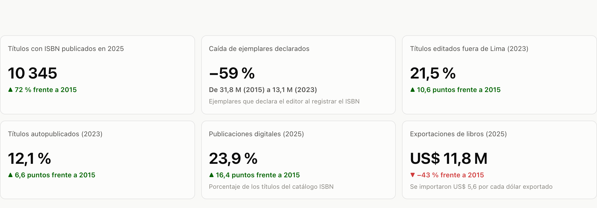
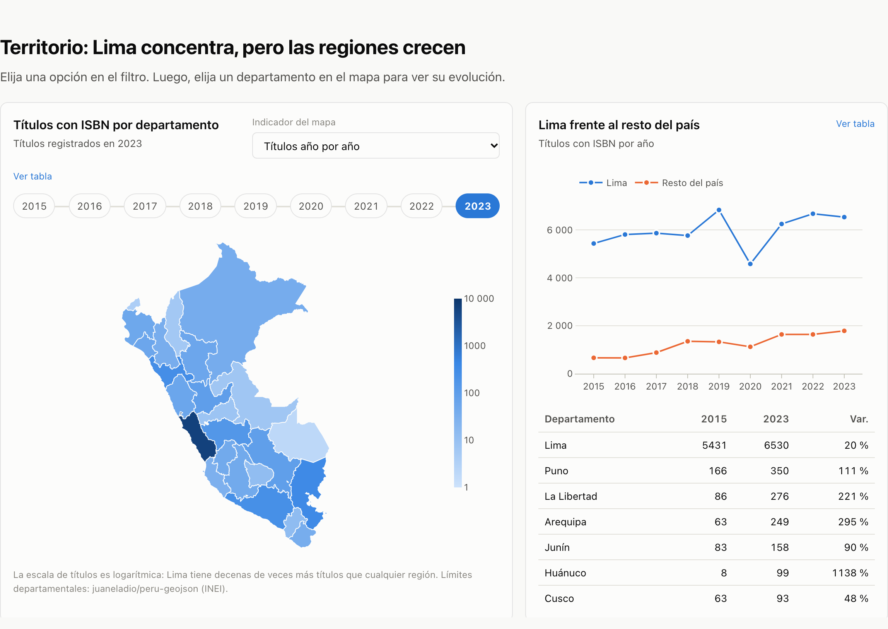

# Más títulos, menos ejemplares: la década editorial del Perú

**Dashboard en línea:** https://susan-montalvo.github.io/produccion-editorial-peru/

**Publicación de LinkedIn:** _(pendiente)_





## Pregunta de investigación

**¿Cómo ha cambiado la producción y la circulación editorial en el Perú en los últimos diez años?**

"Editorial" incluye libros impresos, publicaciones digitales y audiolibros. La producción se mide con el registro ISBN de la Biblioteca Nacional del Perú (BNP): títulos, ejemplares, formatos, tipo de editor y departamento. La circulación se mide con el comercio exterior de libros: cuánto importa y exporta el Perú y con qué países.

**Cobertura:** Perú y sus 25 departamentos, 2015–2025. Las fuentes traen datos desde 2008: se conservan completos en `datos/`, pero el análisis y el dashboard parten de 2015.

## Fuentes de datos

Fecha de descarga: **29 de octubre de 2026**.

| Fuente | Qué aporta | Periodo | Archivo |
|---|---|---|---|
| [InfoArtes – Registro ISBN](https://infoartes.pe/posts/registro-isbn-2008-2023) (Ministerio de Cultura, con datos de la BNP – Agencia Peruana del ISBN) | Títulos, ejemplares, soporte, edición, tiraje, materia, departamento, tipo de editor e idioma | 2008–2023 | `datos/originales/infoartes_registro_isbn_2008_2023.xlsx` |
| [Catálogo ISBN de la BNP](https://isbn.bnp.gob.pe/catalogo.php) | Títulos por año de publicación y ficha de cada publicación electrónica (formato del archivo) | 2008–2025 | `datos/originales/isbn_*.csv` |
| [UN Comtrade](https://comtradeplus.un.org/) (API pública) | Importaciones y exportaciones del Perú por país socio: HS 4901 (libros), 4902 (diarios y revistas), 4903 (álbumes infantiles) | 2015–2025 | `datos/originales/comtrade/` |
| [peru-geojson](https://github.com/juaneladio/peru-geojson) | Límites departamentales (INEI) para el mapa | – | `web/data/peru_departamentos.geojson` |

## Metodología

1. **Obtención** (`scripts/obtener_catalogo_isbn.py`):
   - El Excel de InfoArtes y las respuestas de Comtrade se descargaron tal cual.
   - El catálogo de la BNP muestra 6 títulos por página y sus filtros no se combinan. Por eso se recorrieron las 3 342 páginas de publicaciones electrónicas (20 048 títulos) y se abrió la ficha de cada uno de los 16 142 publicados entre 2015 y 2025 para leer su formato (PDF, ePub, HTML, MP3, etc.). Cada página queda en caché, con 3 consultas en paralelo para no cargar el servidor.
2. **Limpieza** (`scripts/procesar_datos.py`):
   - Las 10 tablas de InfoArtes se pasaron a formato largo (año × categoría). Las celdas "-" se leyeron como 0.
   - **Controles:** cada desagregación se comparó con el total anual. Soporte, comercialización, tiraje y tipo de editor cuadran exactamente. Departamento difiere en 1 título en 2019. Edición tiene entre 44 y 80 títulos sin dato por año hasta 2019. Idioma suma más que el total porque un título puede tener varios idiomas.
   - En Comtrade se comprobó que la suma de países socios cuadre con el total "Mundo". Los códigos M49 se tradujeron a ISO3 y a nombres en español.
   - Los formatos digitales se agruparon en PDF, ePub y otros e-book, HTML, audiolibro ("Formato MP3" y "CD audio estándar"; se excluye "DAISY sin audio") y otros.
3. **Indicadores** (`scripts/analizar_datos.py` → `web/data/datos.json`):
   - **Tiraje promedio** = ejemplares ÷ títulos.
   - **Participaciones** (fuera de Lima, autopublicación, digital, tiraje ≤ 500) = títulos de la categoría ÷ total del año.
   - **Variaciones** entre el primer y el último año.
   - **Razón importación/exportación** de libros (HS 4901).
4. **Dashboard** (`web/`): HTML, CSS y JavaScript con Plotly. Los filtros de periodo, departamento, indicador del mapa, producto y flujo comercial recalculan los KPIs y los gráficos en el navegador. Cada gráfico tiene su vista de tabla, y se pueden descargar en CSV los datos filtrados.

## Hallazgos principales

1. **Se publican más títulos, pero en tirajes mucho más cortos.**
   Entre 2015 y 2023 los títulos con ISBN pasaron de 6 093 a 8 317 (+37 %); en 2025, el catálogo registró 10 345. Pero los ejemplares declarados cayeron 59 %. Típicamente, hasta 2019, el libro se imprimía en 501 a 1 000 ejemplares. Desde 2020, se registran mayores porcentajes de libros impresos en 500 ejemplares a menos.
2. **Lo digital llegó para quedarse; el audiolibro sigue siendo marginal.**
   Las publicaciones digitales pasaron de 7 % de los títulos en 2015 a 33 % en 2020 y se mantienen en 24 % en 2025. El PDF pasó de 33 % a 73 % de lo digital; en cambio, solo 447 títulos se registraron como audio entre 2015 y 2025. Cinco editoriales o instituciones registraron el 95 % de esos audiolibros.
3. **La producción se descentraliza y crece la autopublicación.**
   Entre 2015 y 2023 los títulos editados fuera de Lima casi se triplicaron (662 → 1 787) y Lima bajó de 89 % a 79 % del total. La autopublicación, en la que el autor registra su propio libro, pasó de 5,5 % a 12,1 % de los títulos.
4. **El Perú compra libros afuera y vende cada vez menos.**
   Las exportaciones de libros cayeron de US$ 20,9 M en 2015 a US$ 11,8 M en 2025 (−43 %); mientras las importaciones bajaron mucho menos, de US$ 73,6 M a US$ 65,6 M (−11 %), tras recuperarse de la caída de 2020. En 2025 el Perú importó 5,6 dólares en libros por cada dólar que exportó.

## Limitaciones

- **El ISBN mide la intención de publicar, no las ventas ni la lectura.** Los ejemplares son los que declara el editor al registrar el título.
- **Los audiolibros no tienen un soporte propio en el registro peruano.** Solo hay soporte impreso y digital; un audiolibro se reconoce porque el editor declaró un formato de audio (MP3 o CD de audio) en la ficha. Algunos "CD audio" parecen ser PDF grabados en un CD (por ejemplo, de 1 MB), y muchos audiolibros que se venden en plataformas no se registran en el Perú. Tampoco se contaron 16 títulos con formatos ambiguos ("Audio autónomo", "Audio para lectura acompañada", DAISY con audio): 6 de ellos son programas escolares. La cifra es un piso, no un total.
- **InfoArtes cuenta por año de registro y el catálogo por fecha de publicación declarada,** por eso sus totales difieren algunos cientos de títulos por año. Por esa razón no se mezclan en un mismo gráfico.
- **Los ejemplares tienen años atípicos** (62 millones en 2016), probablemente por compras grandes de textos escolares. Por eso se analiza también la distribución de tirajes.
- **El comercio exterior está en dólares corrientes** y no incluye libros electrónicos, venta informal ni piratería. Algunos años no reportan el peso.

## Cómo reproducirlo

```bash
uv venv .venv && uv pip install --python .venv/bin/python -r requirements.txt

.venv/bin/python scripts/obtener_catalogo_isbn.py totales
.venv/bin/python scripts/obtener_catalogo_isbn.py listado
.venv/bin/python scripts/obtener_catalogo_isbn.py fichas --desde 2015 --hasta 2025   # ~1 h
.venv/bin/python scripts/procesar_datos.py
.venv/bin/python scripts/analizar_datos.py

cd web && python -m http.server 8765    # dashboard en http://localhost:8765
```

Las respuestas de Comtrade ya están en `datos/originales/comtrade/`. Para volver a pedirlas se usa la API pública: `https://comtradeapi.un.org/public/v1/preview/C/A/HS?reporterCode=604&period=<año>&cmdCode=4901&flowCode=M,X`.

**Reel** (en un entorno aparte, ver `reel/requirements.txt`):

```bash
.venv/bin/python scripts/capturas_dashboard.py          # imágenes del dashboard para el video
.venv-reel/bin/python reel/hacer_reel.py --voz reel/mi_voz.mp3 \
    --musica reel/atlasaudio-background-music-610019.mp3 \
    --credito-musica "«Background Music», atlasaudio (Pixabay, licencia de Pixabay)"
```

La música se descarga de [Pixabay](https://pixabay.com/music/) («Background Music», de atlasaudio) y no se incluye en el repositorio. Con `--reusar-audio` se rehace el video sin volver a generar la voz, y con `--rehacer-escena N` se narra de nuevo una sola escena.

## Estructura

```text
├── index.html                 # redirige a web/ (GitHub Pages)
├── datos/                     # ver datos/README.md: fuente de cada archivo
│   ├── originales/            # InfoArtes, Comtrade y catálogo ISBN tal como se descargaron
│   └── procesados/            # tablas largas y limpias
├── scripts/                   # obtener, procesar, analizar yElija una opción en el filtro. Luego, elija un departamento en el mapa para ver su comportamiento en el periodo analizado. capturar
├── web/                       # dashboard: index.html, assets/, data/
├── reel/                      # guion.json, hacer_reel.py, subtitulos.srt, recursos/
└── docs/capturas/             # imágenes del dashboard para LinkedIn
```

## Uso de inteligencia artificial

Usé **Claude Code** para escribir el código de descarga, limpieza, análisis, el dashboard y el script del reel, y para redactar los textos. La narración del reel se generó con **Qwen3-TTS** a partir de una grabación de mi propia voz, y los subtítulos con **Whisper**. La música de fondo es «Background Music», de atlasaudio (Pixabay, licencia de Pixabay), mezclada unos 15 dB por debajo de la voz. Todas las cifras salen de los scripts y las revisé contra las fuentes originales.
